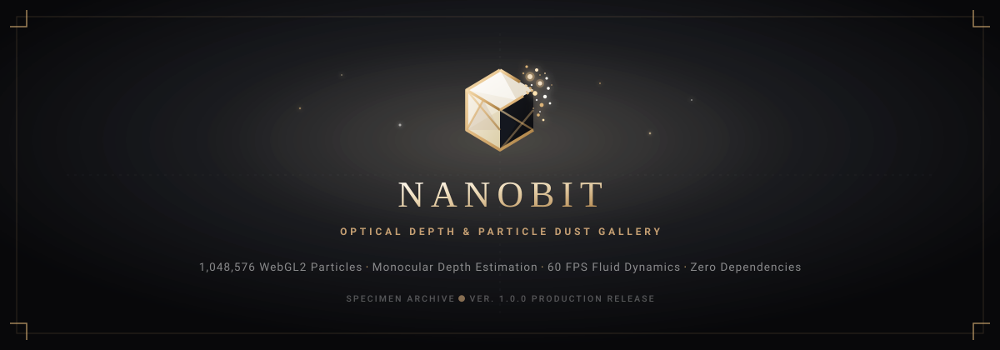
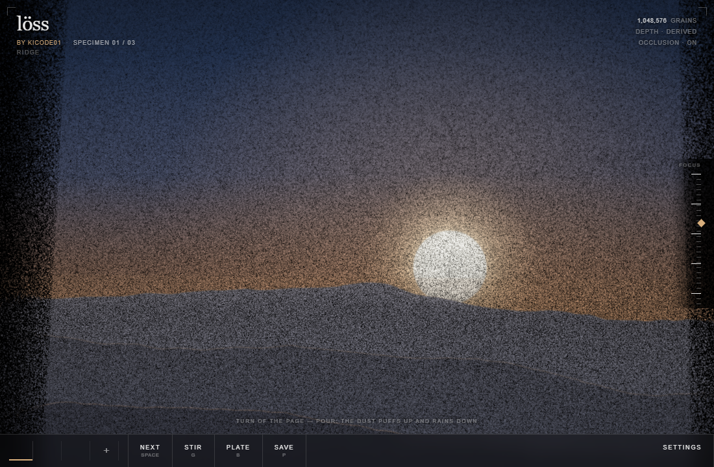
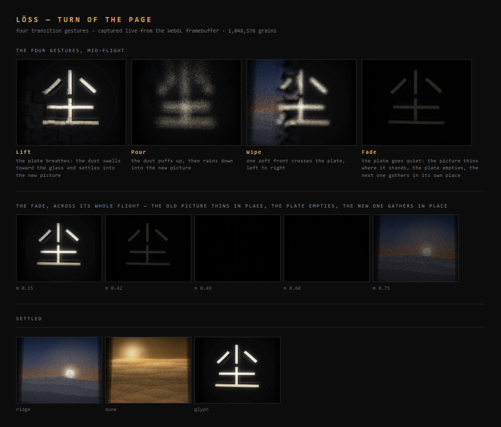
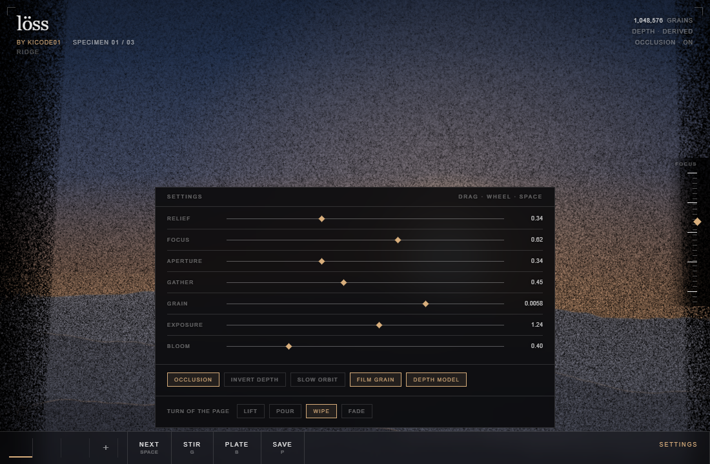

<p align="center">
  <picture>
    <source media="(prefers-color-scheme: dark)" srcset="assets/banner.svg">
    
  </picture>
</p>

<p align="center">
  <strong>Interactive 3D particle dust &amp; optical depth gallery powered by WebGL2 and monocular neural depth estimation.</strong>
</p>

<p align="center">
  <a href="https://nanobit.vercel.app"></a>
  <a href="https://github.com/kicode01/nanobit/releases"></a>
  <a href="#"></a>
  <a href="#"></a>
  <a href="LICENSE"></a>
</p>

<p align="center">
  <a href="#-overview">Overview</a> •
  <a href="#-curated-specimen-archive">Specimens</a> •
  <a href="#-core-capabilities">Capabilities</a> •
  <a href="#-visual-tour">Visual Tour</a> •
  <a href="#-controls--shortcuts">Controls</a> •
  <a href="#-architecture">Architecture</a> •
  <a href="#-releases--versioning">Releases</a> •
  <a href="#-quick-start">Quick Start</a> •
  <a href="#-deployment">Deployment</a>
</p>

---

## 🌟 Overview

**`nanobit`** transforms classical Renaissance sculptures, Post-Impressionist masterworks, and custom user photographs into living, aerodynamic fields of **1,048,576 discrete dust particles** simulated in real-time WebGL2.

Bridging the physical and digital, specimens do not merely transition—they dissolve into swirling quantum dust, breathe under physical fluid vortex currents, and settle into tactile 3D relief sculptures guided by neural monocular depth estimation.

<p align="center">
  
  <em>Figure 1: Vincent van Gogh's "The Starry Night" rendered as 1,048,576 spatial particles with synthetic optical depth of field on dark obsidian glass.</em>
</p>

---

## 🏛️ Curated Specimen Archive

`nanobit` includes a permanent archive of iconic art historical specimens, alongside algorithmic terrain studies:

| Specimen | Original Artist | Period / Origin | Spatial Topology |
| :--- | :--- | :--- | :--- |
| **The Starry Night** | Vincent van Gogh | 1889 (Saint-Rémy) | Volumetric impasto relief & celestial vortex field |
| **David** | Michelangelo Buonarroti | 1504 (Florence) | Marble contrapposto with pronounced anatomic depth |
| **Mona Lisa** | Leonardo da Vinci | c. 1503 (Florence) | Soft sfumato gradients mapped to subtle 3D contours |
| **Girl with a Pearl Earring** | Johannes Vermeer | c. 1665 (Delft) | High-contrast chiaroscuro with pearl specular highlights |
| **Pietà** | Michelangelo Buonarroti | 1499 (Rome) | Intricate drapery folds and sculptural spatial volume |
| **Ridge** | *Algorithmic Study* | Generative | High-frequency erosion topography |
| **Dune** | *Algorithmic Study* | Generative | Continuous wind-swept sand ripples |
| **尘 (Dust) Glyph** | *Typographic Study* | Procedural | Traditional calligraphy particle lattice |

---

## ⚡ Core Capabilities

### 🌪️ 1,048,576 WebGL2 Particles (GPGPU)
Every single particle is an independently simulated, depth-displaced entity rendered via WebGL2 transform feedback and instanced geometry. Particles respond elastically to camera orbits, focal adjustments, and turbulent air bursts.

### 🧠 In-Browser Neural Depth Estimation
User-dragged photos automatically feed into a browser-native monocular depth pipeline (`Depth Anything V2`). The engine constructs continuous geometric depth topographies on the fly without transmitting pixels to any remote server.

### 📜 Dual Tactile Substrates
Toggle effortlessly between two physical presentation plates:
* **Dark Obsidian Glass (`Plate: Dark`)**: High-contrast, glowing phosphorescent particle dust on a deep mineral void.
* **Textured Cotton Rag Paper (`Plate: Rag Paper`)**: Warm, tactile archival paper plate where dark mineral pigments rest like powdered charcoal and sepia inks.

### 📷 Optical Camera & Depth of Field (DoF)
A physically-modeled optical camera pipeline provides authentic focal blur, circle-of-confusion simulations, aperture radius dials, and chromatic bloom flares.

### 💨 Interactive Aerodynamic Turbulence
Press **`g`** or hold down mouse/touch to unleash fluid drag turbulence. Particles break away from the relief substrate, swirling into vortex clouds before gently precipitating back into registration.

### 🔬 Multi-Layer Optical Diagnostic Suite
Toggle diagnostic modes (**`d`**) to inspect:
* Depth-buffer displacement gradients
* Ambient occlusion and surface normal fields
* Focus plane calibration bars
* Real-time point-budget and memory telemetry

---

## 📸 Visual Tour

<p align="center">
  
  <em>Figure 2: Four distinct transition states — particulate dissolve, aerodynamic lift, fluid pour, and geometric horizontal wipe.</em>
</p>

<p align="center">
  
  <em>Figure 3: Built-in Optical Control Studio with real-time sliders for relief extrusion, optical focus, aperture diameter, gather speed, particle diameter, exposure, and chromatic bloom.</em>
</p>

---

## 🎮 Controls & Shortcuts

| Action | Control / Key | Description |
| :--- | :---: | :--- |
| **Next Specimen** | <kbd>Space</kbd> / `Turn` | Dissolves dust particles and gathers into the next artwork |
| **Stir / Gust** | <kbd>G</kbd> / `Stir` | Click for an air gust; hold down pointer to continuously billow |
| **Substrate Toggle** | <kbd>B</kbd> / `Plate` | Physical dissolve between Dark Obsidian Glass &amp; Rag Paper |
| **Save 4K PNG** | <kbd>P</kbd> / `Save` | Exports high-resolution 4K canvas capture with transparency |
| **Studio Panel** | <kbd>O</kbd> / Click Sliders | Opens fine optical tuning panel (Relief, Focus, Aperture, Bloom) |
| **Toggle Chrome UI** | <kbd>H</kbd> | Hides all interface elements for pure museum contemplation |
| **Diagnostic Mode** | <kbd>D</kbd> | Cycles optical debug layers (normals, occlusion, depth buffer) |
| **Pull Focal Plane** | <kbd>↑</kbd> / <kbd>↓</kbd> | Dynamically shifts optical camera focus forward and backward |
| **Orbit Camera** | `Mouse / Touch Drag` | Free-camera 3D spatial rotation around specimen volume |
| **Upload Custom Image** | `Drag & Drop` | Drop any JPEG/PNG into the browser tab for instant 3D neural relief |

---

## 🏗️ Architecture

```
                          ┌────────────────────────┐
                          │  Input Artwork / Photo │
                          └───────────┬────────────┘
                                      │
                   ┌──────────────────┴──────────────────┐
                   ▼                                     ▼
        ┌─────────────────────┐               ┌─────────────────────┐
        │  Curated Specimen   │               │ User Dropped Image  │
        │ Pre-baked Topologies│               │ (Depth Anything V2) │
        └──────────┬──────────┘               └──────────┬──────────┘
                   │                                     │
                   └──────────────────┬──────────────────┘
                                      ▼
                      ┌───────────────────────────────┐
                      │    WebGL2 GPGPU Core Engine   │
                      │   1,048,576 Point Displacement│
                      └───────────────┬───────────────┘
                                      │
            ┌─────────────────────────┼─────────────────────────┐
            ▼                         ▼                         ▼
   ┌─────────────────┐       ┌─────────────────┐       ┌─────────────────┐
   │ Fluid Turbulence│       │ Optical DoF &   │       │ Substrate Pass  │
   │ & Vortex Forces │       │ Chromatic Bloom │       │ Glass vs Paper  │
   └────────┬────────┘       └────────┬────────┘       └────────┬────────┘
            └─────────────────────────┼─────────────────────────┘
                                      ▼
                        ┌───────────────────────────┐
                        │ High-Fidelity 60 FPS Canvas│
                        └───────────────────────────┘
```

### Zero-Framedrop Performance Engineering
1. **Pre-Baked Neural Reliefs**: Built-in masterpieces have their 3D depth and particle coordinates calculated at initial splash boot, enabling seamless **60 FPS** transitions without thread contention.
2. **Rest-Queue Inference**: For custom dropped photos, in-browser neural network inference is scheduled during idle rest periods, preventing frame drops during ongoing camera animations.
3. **Adaptive Device Tiering**: High-end discrete GPUs render full multi-pass depth-of-field and chromatic diffusion; integrated mobile chipsets automatically scale down blur passes to guarantee a locked framerate.
4. **100% Client-Side Privacy**: No external backend servers, no analytics beacons, and no cloud GPU costs. Every calculation executes locally on your hardware.

---

## 📦 Releases & Versioning

### Can a Web-Only Project Have GitHub Releases?
**Yes, absolutely!** Web projects, creative-coding engines, and single-page applications utilize GitHub Releases to:

1. **Tag Immutable Semantic Milestones**: Pin stable milestones (`v1.0.0`, `v1.1.0`) in git history to guarantee reproducibility and point-in-time stability.
2. **Publish Structured Changelogs**: Provide users, collaborators, and star-gazers with transparent release notes documenting shader updates, performance optimizations, and newly curated artworks.
3. **Trigger Automated CI/CD Deployments**: Pushing a release tag automatically triggers continuous delivery pipelines to production edge networks (e.g. Vercel).
4. **Permanent Audit Trail**: Maintain verifiable version history for security, rollback capabilities, and intellectual property protection.

### Creating a New Release
To publish a new release:
```bash
# Create and push a semantic version tag
git tag -a v1.0.0 -m "Release v1.0.0 - Production Launch"
git push origin v1.0.0
```
Our automated GitHub Action [`.github/workflows/release.yml`](.github/workflows/release.yml) publishes the release with generated changelog notes automatically.

---

## 🚀 Quick Start

### Prerequisites
* Any modern web browser supporting **WebGL2** (Chrome, Edge, Firefox, Safari 15+, Brave, Arc)
* (Optional for local development) [Node.js](https://nodejs.org/) v18+

### Running Locally
```bash
# 1. Clone the repository
git clone https://github.com/kicode01/nanobit.git
cd nanobit

# 2. Start a local development server
npm start
# or: npx serve .
```

Open `http://localhost:3000` in your browser.

### Running Headless Audit Tests
`nanobit` includes a comprehensive Playwright validation suite verifying UI component registration, shader bindings, and canvas rendering:
```bash
npm test
```

---

## 🌐 Production Deployment

### Vercel (Recommended)
`nanobit` is pre-configured with [`vercel.json`](vercel.json) for instantaneous edge routing:
```bash
npm install -g vercel
vercel --prod
```

### GitHub Pages
1. Navigate to **Settings > Pages** in your GitHub repository.
2. Set **Source** to `Deploy from a branch` and select `main` / `/ (root)`.
3. Save and your gallery will be live at `https://<username>.github.io/nanobit/`.

### Docker / Nginx
```dockerfile
FROM nginx:alpine
COPY . /usr/share/nginx/html
EXPOSE 80
CMD ["nginx", "-g", "daemon off;"]
```

---

## 📂 Project Structure

```
nanobit/
├── .github/
│   ├── ISSUE_TEMPLATE/
│   │   ├── bug_report.md           # Bug report template
│   │   └── feature_request.md      # Specimen & feature proposal template
│   └── workflows/
│       ├── ci.yml                  # Automated deliverable & schema validation
│       └── release.yml             # Automatic standalone zip builder & release publisher
├── assets/
│   ├── banner.svg                  # Brand product header banner
│   ├── icon.svg                    # Geometric isometric crystal & dust SVG icon
│   ├── ui-main.png                 # Main interface screenshot (Starry Night)
│   ├── ui-panel.png                # Optical studio adjustment panel screenshot
│   └── transitions.png             # Specimen morph & transition sequence showcase
├── .tools/
│   └── audit.js                    # Automated headless Playwright verification suite
├── .gitignore                      # Clean production ignore rules
├── .vercelignore                   # Vercel deployment exclusions
├── CHANGELOG.md                    # SemVer release history & milestone logs
├── CONTRIBUTING.md                 # Contribution, testing, and feedback guide
├── index.html                      # Core WebGL2 client application
├── LICENSE                         # Intellectual property & proprietary license
├── package.json                    # Project metadata, scripts, and release commands
├── README.md                       # Comprehensive product documentation
└── vercel.json                     # Edge CDN routing configuration
```

---

## 📜 Intellectual Property & License

Copyright © 2026 kicode01. All Rights Reserved.  
Proprietary software. Unauthorized copying, distribution, modification, reverse engineering, or commercial exploitation is strictly prohibited. See [LICENSE](LICENSE) for legal terms.

<p align="center">
  
  <br>
  <em>Designed and crafted for contemplative spatial computing.</em>
</p>
